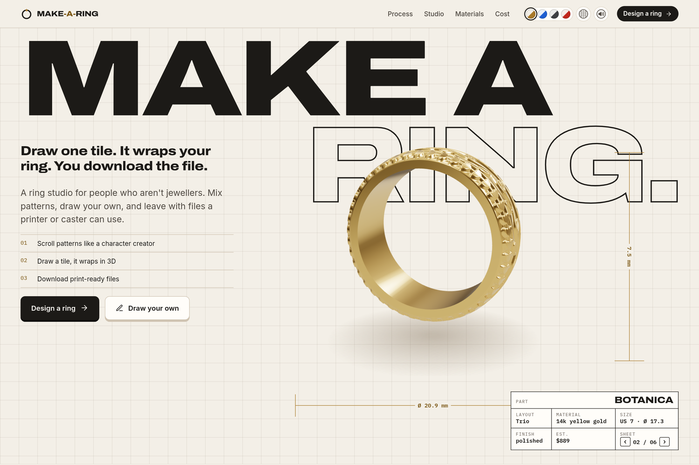
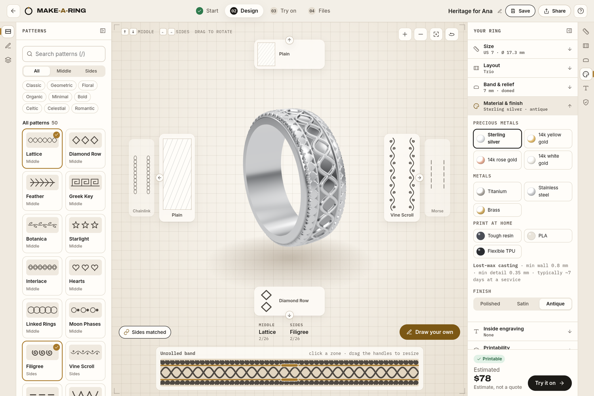
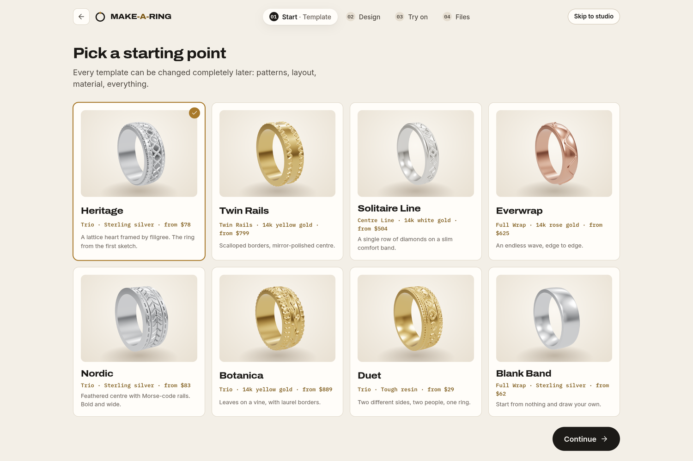
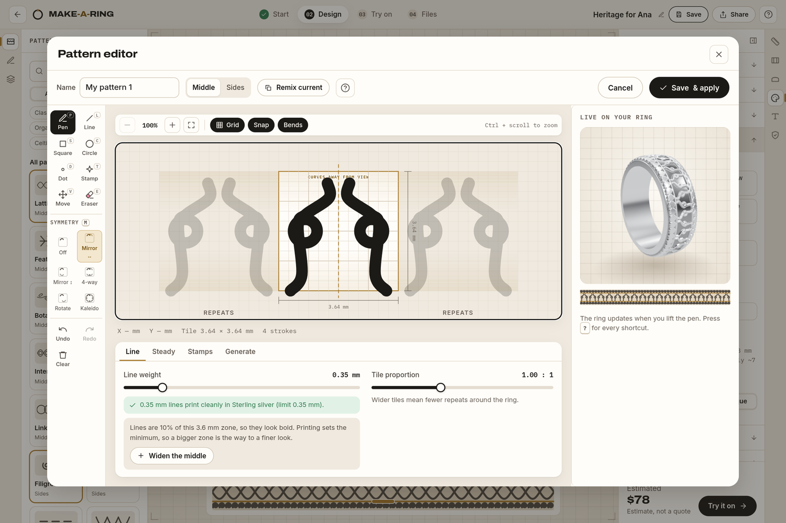
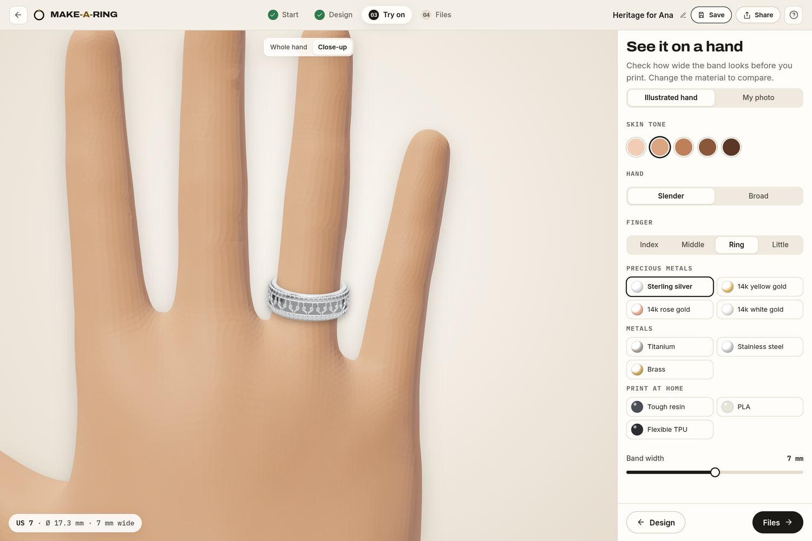
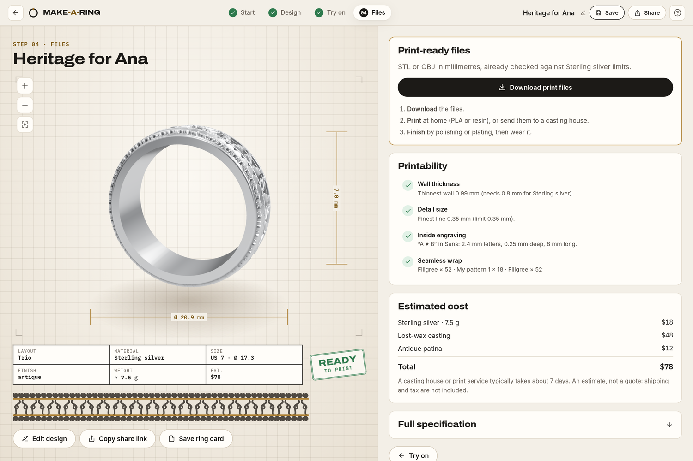
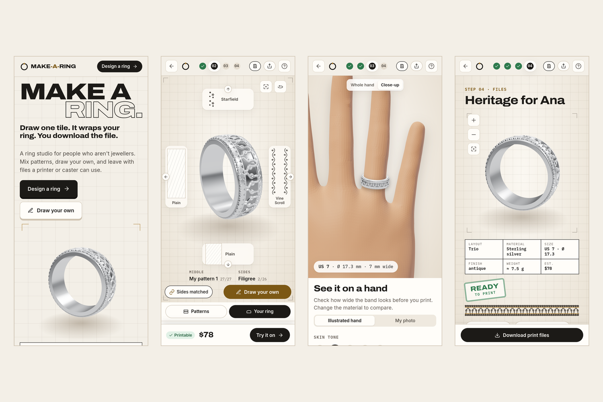

# Make-a-Ring

**Draw one tile. It wraps your ring. You download the file.**

A ring studio for people who aren't jewellers. Scroll patterns like a game character creator, draw your own,
see it on a hand, and leave with a print-ready STL or OBJ, made in your browser.

Built for **HyperBloom October 2026 (UI/UX & Web Design)**.

> **Live demo:** [make-a-ring.deployxa.online](https://make-a-ring.deployxa.online) (hosted on Deployxa) · **Video:** _link added at submission_



## The problem

Custom rings are designed in CAD tools made for professionals, or picked from a short list of presets. Someone with
an idea for a ring has no way to try it, see it at their real size, or hand a maker a file they can use.

## What we made

| | |
|---|---|
|  | **The studio.** A cross carousel around a live 3D ring: up and down change the middle pattern, left and right the sides. The unrolled band underneath shows the whole design flat, with handles to resize each zone. |
|  | **Start anywhere.** Eight templates with real 3D thumbnails, or one of your saved designs. A size step with a dimensioned drawing you can drag, and a size finder that uses a card you already own. |
|  | **Draw your own.** Sketch one tile with mirror, rotate or kaleidoscope symmetry; it repeats seamlessly around the band, and the ring on the right updates when you lift the pen. Line weights are checked against the material while you draw. |
|  | **Try it on.** A 3D hand in five skin tones, two builds and four fingers, or a photo of your own hand, uploaded or taken with the camera. The ring is drawn at true scale. |
|  | **Check and download.** A drawing sheet with a READY TO PRINT stamp, printability checks with real limits per material (wall thickness, detail size, seamless wrap) and one-click fixes, an itemised estimate, STL/OBJ files with a maker brief, and a ring card to share. |
|  | **On a phone.** The ring fills the first screen, the panels become tabs, and the price and Try it on stay docked at the bottom. |

## Design decisions

- **A drafting table, not a shop.** Grid, registration marks, dimension lines and a title block: the ring is presented
  like a part being made, which is what it is. The rules are written down in [`brand/brand-guide.pdf`](brand/brand-guide.pdf).
- **The ring is always the hero.** It is the bottom layer of the stage and is never boxed in; the interface scales down
  on small or zoomed screens so the ring keeps its room.
- **One gesture to explore.** Scrolling patterns needs no menus, and the arrow keys do the same. Drawing your own tile
  repeats it seamlessly around the band, with mirror and kaleidoscope symmetry.
- **Honest numbers.** Sizes in US, EU and UK with the real inner diameter; wall and detail limits from each material;
  prices marked as estimates.
- **Calm motion and sound.** Pages change behind a single curtain sweep, so content never flickers. Quiet sounds
  (a measuring-tape ratchet for sizes, a chime when files are ready) are paired with something you can see and can be
  muted.

## Accessibility

- Everything works by keyboard: arrows drive the carousel, `?` lists every shortcut, the size drawing is a slider, and
  the pattern editor draws with arrows and Enter.
- Pattern changes and modes are announced to screen readers; controls have labels and roles (radiogroups, tablists,
  sliders).
- `prefers-reduced-motion` turns off transitions, the turntable and animated tours.
- Status is never colour alone: checks carry an icon and words.
- Four colour themes built on the same tokens, so every control looks right in each.
- axe-core 4.10 reports 0 WCAG 2.2 AA violations on all five screens in all four themes, and on a phone-sized screen.

## Try it in 60 seconds

1. **Design a ring** → pick a template → set your size.
2. In the studio press **↑ ↓ ← →** and watch the ring change.
3. Click **Draw your own**, draw a few strokes with mirror symmetry on, and press **Save & apply**.
4. **Try it on**, then **Files** → **Download print files**.

## Run it locally

No build step and no npm. Any static server works; this one fixes `.js` MIME types on Windows:

```bash
python serve.py
```

Then open http://localhost:5173. Libraries (Preact, htm, three.js, three-subdivide) load from jsDelivr via the import map in `index.html`.
The try-on hand is the WebXR generic-hand model (`assets/hand-right.glb`, MIT, © 2019 Amazon, from `@webxr-input-profiles/assets`).
To deploy, upload the folder as a static site; there is nothing to build. The live demo runs on [Deployxa](https://deployxa.com): `npx @deployxa/cli login`, then `npx @deployxa/cli deploy` in the folder (detected as a static site).

Frontend-only prototype: no backend, no accounts, no real brands. Prices are estimates; the STL and OBJ files are real.

## Code map

| Path | What it does |
|---|---|
| `src/lib/patterns.js` | Pattern library. Each pattern is one tile of strokes in 0..1 tile space |
| `src/lib/templates.js` | Layouts, adjustable zone proportions (`layoutZones`) and templates |
| `src/lib/materials.js` | Materials: render look, min wall/detail, price inputs, plating |
| `src/lib/band.js` | Zone sizes, tile repeats and printable line width |
| `src/lib/heightmap.js` | Draws all zones into a heightmap of the unrolled band |
| `src/lib/ringGeometry.js` | Revolves the band profile and displaces the outer surface with the heightmap |
| `src/lib/viewer.js` | three.js scene (studio, hero and try-on modes) |
| `src/lib/checks.js` | Printability checks with one-click fixes, plus the price estimate |
| `src/lib/thumbnails.js` | Off-screen renderer for template thumbnails |
| `src/state.js` | Global store, actions, persistence (localStorage), share links |
| `src/components/stage.js` | The cross carousel |
| `src/components/editor.js` | Pattern editor (zoom, grid, square/move tools, Steady smoothing, line weight in mm). Strokes placed with symmetry remember their copies: with symmetry on, erasing, moving, deleting or smoothing one copy acts on all of them; with it off, only on the one you touch. On phones it goes full screen with the tools pinned as swipeable rows above a larger canvas |
| `src/components/rail-strip.js` | Category icon strip for the studio side panels |
| `src/lib/engraving.js` | Inside engraving: presets (initials, A for B, A ♥ B, love, custom), letter-size limits and the inner-surface heightmap cut into the mesh |
| `src/components/tour.js` | Guided tours (5 core studio steps, or all 10 from the help menu) and tips |
| `src/screens/*` | One file per screen |

## Adding a pattern

Add a `def(...)` entry in `src/lib/patterns.js`. Zone is `'middle'`, `'side'` or `'any'`.
For side patterns, `y = 0` is the outer edge of the ring.

## License

Make-a-Ring is source-available under the [PolyForm Noncommercial License 1.0.0](LICENSE.md).

Required Notice: Copyright (c) 2026 Franciszek Kossut and emermelada (https://github.com/FearedLynx/make-a-ring)

You may read, run, study and change the code, and share it, for any **noncommercial** purpose: personal projects,
learning, research, hobby use, and use by charities, schools and public institutions. **Any commercial use needs
written permission from both authors**: selling it or a product built on it, running it as a paid service, or using
it in a business. To ask, open an issue on this repository.

**Name, logo and brand.** The license covers using the software. It does not give anyone the right to use the
Make-a-Ring name, the logo or the visual identity in `brand/`; those stay with the authors.

This summary is only for convenience; [LICENSE.md](LICENSE.md) is what applies.
